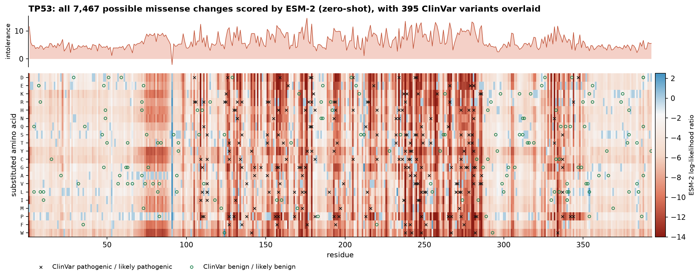
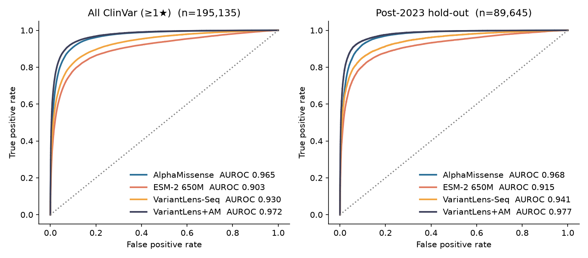
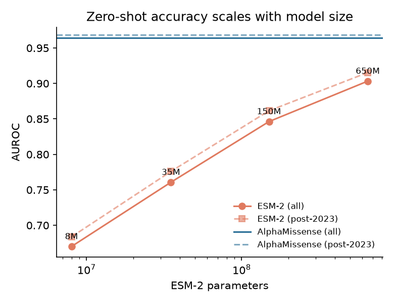
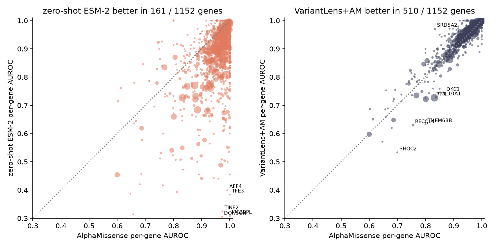
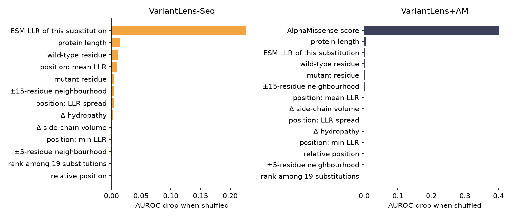

# 🧬 VariantLens

**How far can a protein language model that has never seen a single clinical label go at diagnosing human disease mutations, and can it make DeepMind's AlphaMissense better?**

VariantLens scores every possible missense mutation in 14,870 human proteins with Meta's **ESM-2** protein language model, benchmarks it head-to-head against **AlphaMissense** on **195,135 expert-labelled ClinVar variants** (including a leakage-free *post-2023* hold-out), and ships the result as an **interactive web app** with full mutational landscapes and AlphaFold structures.


<sub>Every possible amino-acid change in the tumour suppressor p53, scored by a model that has never seen a clinical label. Pathogenic ClinVar variants (×) fall in the deep-red DNA-binding domain (residues ~100–290); benign ones (○) sit in the tolerant, disordered termini. Reproduce with `python scripts/06_hero_figure.py TP53`.</sub>

## Headline results

| Method | Training signal | AUROC: all ClinVar (n = 195,135) | AUROC: post-2023 hold-out (n = 89,645) |
|---|---|---|---|
| ESM-2 650M, zero-shot | none (sequences only) | 0.903 (0.902–0.905) | 0.915 (0.913–0.918) |
| **VariantLens-Seq** | ESM-2 landscape + ClinVar | **0.930** (0.929–0.932) | **0.941** (0.939–0.943) |
| AlphaMissense | structure + MSA + population | 0.965 (0.964–0.965) | 0.968 (0.967–0.969) |
| **VariantLens+AM** | AlphaMissense + ESM-2 landscape | **0.972** (0.971–0.973) | **0.977** (0.976–0.978) |

<sub>95 % bootstrap CIs. VariantLens numbers are out-of-fold predictions from 5-fold cross-validation **grouped by gene**: every score comes from a model that never saw that gene.</sub>

1. **A purely self-supervised model gets you 90 % of the way.** ESM-2 never saw a label, a structure or a population database, yet it ranks pathogenic above benign variants with AUROC 0.90–0.92.
2. **Accuracy scales log-linearly with model size**: 0.67 → 0.76 → 0.85 → 0.90 for 8M → 35M → 150M → 650M parameters.
3. **The landscape around a mutation carries signal the single-cell score misses.** A gradient-boosted model on ESM-2 landscape features (position intolerance, neighbourhood intolerance, amino-acid chemistry) lifts sequence-only performance from 0.903 to 0.930 on unseen genes.
4. **The cheap scoring mode is almost free.** On a random 25,000-variant subset, masked-marginal scoring (one forward pass per *position*) reaches AUROC 0.908 vs 0.903 for wild-type marginals (one pass per *protein*, ~40× cheaper; Spearman ρ = 0.988). That is what makes proteome-scale landscapes feasible on a laptop GPU.
5. **ESM-2 is complementary to AlphaMissense.** When the two disagree strongly (6,493 variants), ESM-2 is right 47 % of the time. Combining them beats AlphaMissense on both splits, with non-overlapping CIs, and gives higher per-gene AUROC in 510 vs 327 genes (Wilcoxon p = 1.4 × 10⁻¹¹).

| | |
|---|---|
|  |  |
|  |  |

## The web app

```bash
streamlit run app/app.py
```

* **Variant explorer**: pick any of 14,870 proteins and type a variant (`R175H`). You get the ESM-2 LLR, the VariantLens probability, AlphaMissense and the ClinVar record. The full 20 × L mutational landscape can be coloured by any of the three models, with ClinVar variants overlaid. The positional-sensitivity track is painted onto the **AlphaFold structure** in 3D.
* **Score any sequence**: paste a designed protein, an ortholog or an enzyme you are engineering, and get the complete landscape plus the most damaging and the most favourable (candidate stabilising) substitutions in seconds.
* **Benchmark**: every number and figure in this README, live.

## How it works

```
ClinVar (P/LP vs B/LB, ≥1★) ──┐
                              ├─ join on GRCh38 chrom:pos:ref:alt ─► 195k variants → UniProt canonical isoform
AlphaMissense hg38 (71M) ─────┘                                           │
                                                                          ▼
                     ESM-2 (8M / 35M / 150M / 650M) on RTX 4060 laptop GPU, fp16
                       • wild-type marginal: 1 pass/protein → full L×20 landscape
                       • masked marginal:   1 pass/position (ablation subset)
                       • sliding 1022-residue windows for long proteins (TTN = 34,350 aa)
                                                                          ▼
                  landscape features ─► HistGradientBoosting (gene-grouped 5-fold CV)
                                                                          ▼
                       benchmark · per-gene AUROC · scaling · ablations · Streamlit app
```

**Scoring.** For a substitution *wt → mt* at position *i*, `LLR = log p(mt | x) − log p(wt | x)` (Meier et al., 2021). Negative means the model finds the mutant less evolutionarily plausible than the wild type.

**Joining without HGVS parsing.** ClinVar and AlphaMissense are joined on genomic coordinates. This hands every ClinVar SNV the exact UniProt isoform and protein change AlphaMissense uses. Variants whose reference residue does not match the current UniProt sequence are dropped (1.2 %).

**Temporal hold-out.** A variant is *post-2023* if it had no P/LP/B/LB classification in the **August 2023** ClinVar release, the month AlphaMissense was published. ESM-2 was trained on 2021 UniRef. Neither model could have seen these labels in any form.

**No gene leakage.** Variants in the same gene share a lot of signal: same protein, same domains, often the same submitter. VariantLens is therefore trained and evaluated with `GroupKFold` on gene symbol, so the reported numbers measure generalisation to *new genes*.

## Honest caveats

* **Protein length is VariantLens-Seq's second most important feature.** This is partly a dataset shortcut: in ClinVar, long proteins (TTN, NEB, …) carry many likely-benign variants. It is still predictive on unseen genes, but it is a property of ClinVar's ascertainment as much as of biology.
* AlphaMissense's *thresholds* were calibrated on ClinVar. AUROC is threshold-free, but the post-2023 split is the cleaner comparison.
* ClinVar labels are biased toward well-studied genes and easy-to-classify variants. "Likely benign" calls from single submitters dominate the benign class.
* VariantLens+AM is worse than AlphaMissense in 327 genes (e.g. SHOC2, TTN, COL10A1). The gain is real on average, but it is not uniform.
* These are research scores, **not** clinical classifications.

## Reproduce

Developed on Windows 11, Python 3.12, a laptop RTX 4060 (8 GB). Full ESM-2 scoring of all four model sizes takes about 45 min.

```bash
python -m venv .venv && source .venv/bin/activate        # Windows: .venv\Scripts\activate
pip install torch --index-url https://download.pytorch.org/whl/cu128
pip install -r requirements.txt
bash scripts/run_all.sh          # downloads ~1.3 GB, scores, trains, benchmarks, builds app data
pytest -q tests
streamlit run app/app.py
```

| Step | Script |
|---|---|
| ClinVar × AlphaMissense benchmark, temporal split | `scripts/01_build_benchmark.py` |
| UniProt sequences + reference-residue QC | `scripts/02_fetch_sequences.py` |
| ESM-2 scoring and landscapes | `scripts/03_score_esm.py`, `scripts/run_scoring.sh` |
| VariantLens meta-models | `scripts/04_train_variantlens.py` |
| Metrics and figures | `scripts/04_benchmark.py` → `results/` |
| App data bundle | `scripts/05_build_app_data.py` |

## References

* Lin et al. (2023) *Evolutionary-scale prediction of atomic-level protein structure with a language model.* Science. (ESM-2)
* Meier et al. (2021) *Language models enable zero-shot prediction of the effects of mutations on protein function.* NeurIPS.
* Cheng et al. (2023) *Accurate proteome-wide missense variant effect prediction with AlphaMissense.* Science.
* Brandes et al. (2023) *Genome-wide prediction of disease variant effects with a deep protein language model.* Nature Genetics.
* Landrum et al. *ClinVar.* Nucleic Acids Research.

AlphaMissense predictions are © Google DeepMind, CC BY-NC-SA 4.0 (non-commercial). ClinVar is public domain. ESM-2 weights are MIT-licensed.
